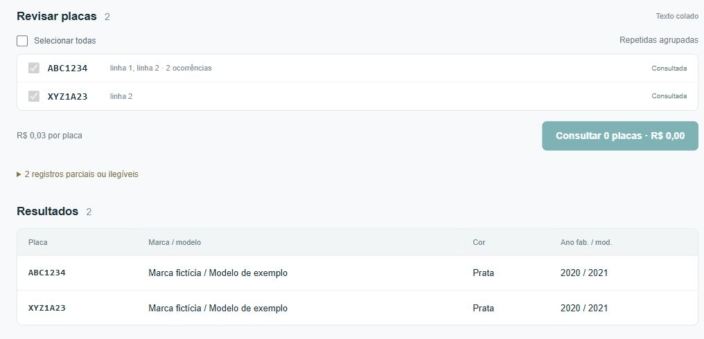
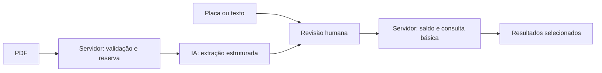

# Consultar Placas

O projeto surgiu de uma demanda do **CIVITAS, central de inteligência para auxílio a investigações**: consultar múltiplas placas em um único fluxo, sem precisar organizar e pesquisar cada uma manualmente.

A solução integra a **API da OpenAI**, que interpreta os documentos e extrai as placas, à **API de placas**, que retorna os dados veiculares. Entre a extração e a consulta, a pessoa revisa os registros, seleciona as placas e confere o custo do lote.

**O foco do projeto:** manter a pessoa no controle do que será consultado e do custo, sem pedir que ela organize cada placa manualmente.

> Este repositório é uma edição de portfólio. A aplicação operacional é privada. A demonstração usa apenas dados fictícios, não envia documentos e não acessa APIs externas.



## Experimente em dois minutos

Requer Node.js 22.13 ou superior.

```sh
npm ci
npm run dev
```

Abra o endereço local exibido no terminal. Em **Colar texto**, use:

```text
ABC-1234
ABC1234; XYZ1A23
AB?1234; SEM LEITURA
```

A interface agrupa a placa repetida, preserva as linhas de origem e separa os registros incompletos. Revise a seleção e clique em consultar para ver respostas fictícias. Os valores exibidos são ilustrativos. A aba PDF explica que a extração está desativada na demonstração.

## O que foi construído

- **Três entradas, uma revisão:** placa individual, extração determinística de texto e leitura integral de PDF por IA na aplicação privada.
- **Consulta consciente:** seleção explícita, custo visível, lote sequencial e parada após a consulta em andamento.
- **Resultados enxutos:** marca, modelo, cor e anos; campos ausentes continuam ausentes.
- **Tratamento de incerteza:** falhas interrompem o lote; o sistema não repete automaticamente uma operação que pode ter sido cobrada.
- **Orçamento para PDFs:** reserva atômica no banco e identificação do documento por hash evitam gerações concorrentes duplicadas.

## Como as APIs entram no fluxo



A API veicular recebe a placa somente depois da confirmação. O servidor verifica saldo, produto e preço antes da chamada e devolve apenas os campos usados pela tela. Credenciais ficam no ambiente do servidor; redirecionamentos e repetição automática são bloqueados.

A API de IA tem outra função: extrair registros do PDF, inclusive parciais e ilegíveis, em um schema estruturado. Ela não fornece dados de veículos. O documento inteiro passa por limites de tamanho, páginas e tokens; o resultado é validado antes da revisão humana. PDF e nome original não são persistidos pela aplicação; a extração e os registros de uso ficam no banco privado.

A demonstração substitui essas chamadas por um adaptador em memória. O código dos serviços está preservado para leitura e testes, com o endereço veicular substituído por um domínio reservado de exemplo.

## Leia o código pelo caminho mais curto

| Arquivo | O que mostra |
| --- | --- |
| [app/page.tsx](app/page.tsx) | Fluxo da interface React, revisão e consulta sequencial |
| [lib/plates.mjs](lib/plates.mjs) | Extração local, normalização e agrupamento |
| [lib/consulta.mjs](lib/consulta.mjs) | Integração veicular no servidor e tratamento de falhas |
| [lib/extraction.mjs](lib/extraction.mjs) | PDF, saída estruturada, validação e deduplicação |
| [lib/budget.mjs](lib/budget.mjs) | Reserva de orçamento e contabilização do uso |
| [demo/mock-api.ts](demo/mock-api.ts) | Respostas fictícias, sem rede |

**Stack:** React, TypeScript, JavaScript, Workers, SQLite/D1 e APIs HTTP. A edição demonstrativa usa Vite; a aplicação privada usa Vinext em Workers.

## Verificação e limites

```sh
npm test
npm run build
```

Os testes usam respostas sintéticas e SQLite/D1 local via Miniflare. Exercitam bloqueio de origem e entrada inválida, redirecionamentos, cobrança incerta, concorrência, deduplicação e limite mensal. Não consultam placas nem chamam modelos reais.

Os serviços são material de estudo, não um servidor público pronto para implantação. A identidade recebida em cabeçalho depende de um gateway confiável que autentique o usuário e remova cabeçalhos forjados. A arquitetura original é de acesso restrito a um único proprietário; um produto multiusuário exigiria autorização e isolamento por usuário.

A prevenção de repetição das consultas veiculares está na sessão da interface: não garante idempotência entre abas ou após recarregar. O orçamento de IA cobre as chamadas feitas por esse serviço, não toda a conta. Modelo, tarifas e limites no código são um retrato da implementação e precisam ser revalidados antes de qualquer uso real. IA pode errar a leitura; validar formato e páginas não comprova a exatidão do conteúdo.

## Sobre esta edição

Inclui a interface e o núcleo da lógica, com adaptações explícitas para demonstração. Exclui credenciais, identificadores de hospedagem, endereço da aplicação privada, documentos, consultas reais, saldos reais e histórico operacional. O histórico Git começa nesta edição sanitizada.

Projeto de **Victor Henrique Rosa da Baptista**, desenvolvido com apoio de IA na implementação e revisão.
